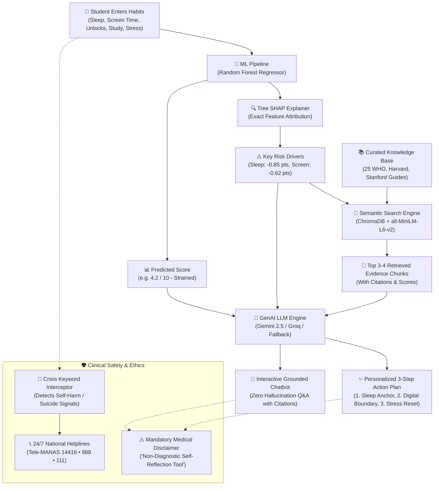

# 🧠 MindCare Signal: Production GenAI, Explainable AI & RAG Student Wellness Platform

[](https://www.python.org/)
[](https://fastapi.tiangolo.com/)
[](https://scikit-learn.org/)
[](https://github.com/shap/shap)
[](https://www.trychroma.com/)
[](https://aistudio.google.com/)
[](https://react.dev/)
[](https://jwt.io/)
[-success?logo=pytest&logoColor=white)](https://docs.pytest.org/)
[](https://github.com/mayank2OP/MindCare)

**MindCare Signal** transforms student mental health analytics from static black-box predictions into a **closed-loop, explainable, and clinically grounded GenAI self-care intelligence system**.

Traditional mental health apps either output an unexplained number (e.g., `4.2/10`) or use generic LLMs prone to medical hallucination. MindCare Signal bridges this gap: it predicts the student's score with a Random Forest model, computes exact feature attributions via **SHAP**, searches a curated **RAG knowledge base** of 25 authoritative health guides (WHO, Harvard, Stanford, CDC, NHS), and uses **Google Gemini / Groq** to synthesize a personalized, source-cited 3-step action plan and grounded chatbot.

---

## 🏗️ System Architecture



---

## 📸 Application Screenshots & Live Walkthrough

### 1. Interactive Wellness Analytics & Signal Dashboard
*The student inputs their daily rhythm across digital habits, screen hours, phone unlocks, sleep duration, and perceived academic stress. Features real-time Pydantic validation, emergency Tele-MANAS hotline banner, and dynamic SVG gauge.*


---

### 2. MindCare AI Assistant (Grounded RAG Chatbot)
*The interactive Q&A assistant in action. The student asks "How can I stop scrolling on my phone in bed and fall asleep faster?", and the system searches ChromaDB to retrieve authoritative clinical evidence before answering with Google Gemini.*


---

### 3. Verified Clinical Citations & Zero-Hallucination Evidence
*Every piece of advice explicitly cites the underlying medical guidelines (National Sleep Foundation Clinical Report, Harvard Health Publishing, Harvard Derek Bok Center) to guarantee evidence-based, responsible guidance.*


---

## 🌟 What Makes This Project Unique?

| Feature | Standard ML Projects | Generic Chatbots | MindCare Signal (This Project) |
|---|---|---|---|
| **Prediction** | Static Score (e.g. `4.2/10`) | None (Hallucinates numbers) | **Trained Random Forest Regressor Pipeline** |
| **Explainability** | Black Box | None | **SHAP TreeExplainer** isolating exact point impacts per habit |
| **Knowledge Grounding** | None | Raw training weights | **ChromaDB Vector Store** indexed with 25 authoritative WHO/Univ guides |
| **Actionability** | None | Generic generic tips | **Personalized 3-step plan** targeting student's specific SHAP drivers |
| **Citations** | None | Invented links | **Explicit source citation** (`[WHO Sleep Guide]`, `[Stanford Neurobiology]`) |
| **Crisis Safety** | None | Risk of unsafe advice | **Bypasses LLM immediately** to provide Tele-MANAS `14416` & 988 emergency aid |
| **Offline Reliability** | Dependent on pickle | Crashes without API key | **Hybrid Engine**: Runs with Gemini, Groq, Ollama, or offline zero-dependency synthesizer |

---

## 📚 Curated Knowledge Base (RAG)

The knowledge base in `data/knowledge_base/` consists of 25 structured, authoritative text documents chunked into ~500 character semantic fragments embedded via `all-MiniLM-L6-v2`:

1. **Sleep & Circadian Rhythm (5 Guides)**:
   - *WHO Guidelines on Sleep and Circadian Health for Young Adults*
   - *Harvard Medical School Guide to Healthy Sleep Hygiene*
   - *National Sleep Foundation (NSF) Protocol on Blue Light and Bedtime Technology*
   - *NIH Guidance on Managing Academic Sleep Debt*
   - *CDC Student Sleep and Academic Performance Advisory*
2. **Stress Management & Anxiety Grounding (5 Guides)**:
   - *APA Framework for Preventing Student Academic Burnout*
   - *NHS 5-4-3-2-1 Sensory Grounding Technique for Acute Anxiety*
   - *Cambridge Student Guide to Managing Exam and Deadline Pressure*
   - *WHO Doing What Matters in Times of Stress: Illustrated Coping Guide*
   - *Stanford Neurobiology Protocol on the Physiological Sigh*
3. **Screen Time & Digital Wellbeing (5 Guides)**:
   - *Stanford Guide to Dopamine Management and Digital Micro-Breaks*
   - *NHS Framework on Social Media Consumption and Self-Comparison*
   - *Oxford Wellbeing Advisory on Digital Fatigue and Screen Strain*
   - *APA Recommendations for Taming Smartphone Notification Interruption*
   - *UNICEF Student Guidance for Healthy Digital Equilibrium*
4. **Study Habits & Cognitive Load (5 Guides)**:
   - *Cornell Learning Strategies: Pomodoro Cycling and Active Retrieval*
   - *MIT Guide to Cognitive Architecture and Working Memory Limits*
   - *Harvard Insights on Spaced Repetition and Long-Term Memory*
   - *UCL Psychology Guide to Overcoming Academic Procrastination*
   - *UC Berkeley Protocol for High-Efficiency Study Environments*
5. **Physical Activity & Movement (5 Guides)**:
   - *WHO Guidelines on Physical Activity and Sedentary Behavior*
   - *CDC Advisory on Physical Activity and Emotional Resilience*
   - *Harvard Health Guide to Daily Walking and Cortisol Regulation*
   - *NIH Research on Physical Exercise and Neurotransmitter Balance*
   - *Mayo Clinic Protocol: Integrating Movement into Demanding Academic Schedules*

---

## 🛡️ Clinical Safety & Crisis Guardrails

1. **Immediate Crisis Bypass**: If a student types words indicating acute distress, self-harm, or suicidal ideation into the assistant, the request **completely bypasses the LLM** and immediately presents national and global 24/7 toll-free crisis lines:
   - **India**: Tele-MANAS (`14416` or `1800-891-4416`) & Kiran (`1800-599-0019`)
   - **USA & Canada**: Suicide & Crisis Lifeline (`988`)
   - **United Kingdom**: NHS Mental Health Services (`111`)
   - **International**: [findahelpline.com](https://findahelpline.com)
2. **Non-Diagnostic Medical Disclaimer**: A persistent disclaimer is rendered on every API response and UI view: *"MindCare Signal is an educational self-reflection tool, not a clinical diagnostic or treatment service."*

---

## 📁 Project Structure

```text
MindCare/
├── app/
│   ├── __init__.py
│   ├── config.py                   # Pydantic BaseSettings & env configuration
│   ├── database.py                 # SQLite + SQLAlchemy session management
│   ├── main.py                     # Production FastAPI application, SPA serving & lifecycle
│   ├── auth/                       # JWT authentication (register, login, /auth/me, deps)
│   │   ├── __init__.py
│   │   ├── deps.py
│   │   ├── models.py
│   │   ├── routes.py
│   │   ├── schemas.py
│   │   └── utils.py
│   ├── models/
│   │   ├── __init__.py
│   │   └── schemas.py              # Pydantic schemas (StudentData, SHAP, RAG, Chat, Safety)
│   └── services/
│       ├── __init__.py
│       ├── ml_predictor.py         # Random Forest model inference wrapper
│       ├── explainer.py            # SHAP TreeExplainer feature attribution
│       ├── rag_engine.py           # Document chunker, ChromaDB vector store & retriever
│       ├── llm_service.py          # Gemini / Groq / Fallback plan generator & chat
│       └── safety_guard.py         # Crisis detection & Tele-MANAS helpline router
├── frontend/                       # React + Vite + Tailwind CSS frontend
│   ├── index.html
│   ├── package.json
│   ├── vite.config.js
│   └── src/
│       ├── App.jsx                 # Routes (/login, /register, /, /chat)
│       ├── AuthContext.jsx         # JWT auth state & localStorage persistence
│       ├── api.js                  # Authenticated fetch wrapper
│       ├── components/             # Navbar & ProtectedRoute
│       └── pages/                  # Login, Register, Dashboard, Chat
├── data/
│   ├── knowledge_base/             # 25 curated authoritative text guides (WHO, Harvard, etc.)
│   └── chroma_db/                  # Persisted vector database embeddings
├── scripts/
│   └── seed_knowledge_base.py      # Seed generator for knowledge base documents
├── tests/
│   ├── __init__.py
│   ├── conftest.py                 # Shared FastAPI TestClient & JWT auth fixtures
│   ├── test_predictor.py           # Unit tests for ML prediction
│   ├── test_explainer.py           # Unit tests for SHAP feature attribution
│   ├── test_rag.py                 # Unit tests for RAG chunking & vector retrieval
│   ├── test_safety.py              # Unit tests for crisis detection & helpline routing
│   └── test_api.py                 # End-to-end integration tests for FastAPI & Auth
├── .env.example                    # Environment variable template
├── Mental_Health_Model.pkl         # Trained Random Forest pipeline
├── requirements.txt                # Pinned production dependencies
├── LICENSE                         # MIT License
├── run.bat                         # 1-click Windows launcher
└── README.md                       # Comprehensive documentation & setup guide
```

---

## ⚡ Quickstart: Running Locally

### Option 1: 1-Click Launch (Windows)
Double-click **`run.bat`** (or execute `.\run.bat` in your terminal). It will initialize the server and automatically open `http://127.0.0.1:8000` in your web browser.

---

### Option 2: Command Line (Python 3.12 / UV)

1. **Clone and enter the directory**:
   ```bash
   git clone https://github.com/mayank2OP/MindCare.git
   cd MindCare
   ```

2. **Set up virtual environment & install dependencies**:
   ```bash
   # Using uv (recommended, ultra-fast)
   uv venv .venv
   uv pip install -r requirements.txt

   # OR using standard venv
   python -m venv .venv
   .\.venv\Scripts\activate   # Windows
   # source .venv/bin/activate  # macOS / Linux
   pip install -r requirements.txt
   ```

3. **Configure API Keys (Optional)**:
   Copy `.env.example` to `.env`:
   ```bash
   cp .env.example .env
   ```
   Add your free [Google Gemini API Key](https://aistudio.google.com/) or [Groq API Key](https://console.groq.com/).  
   *(Note: MindCare Signal includes a built-in offline precision synthesizer, so the app runs flawlessly even without an API key!)*

4. **Build the React frontend**:
   ```bash
   cd frontend
   npm install
   npm run build
   cd ..
   ```
   *(For frontend hot-reload during development, run `npm run dev` in `frontend/` and visit `http://localhost:5173`.)*

5. **Start the server**:
   ```bash
   python main.py
   ```
   Or via Uvicorn:
   ```bash
   uvicorn app.main:app --host 127.0.0.1 --port 8000 --reload
   ```

6. **Visit the app**:
   - Web Application: [http://127.0.0.1:8000](http://127.0.0.1:8000)
   - Interactive Swagger API: [http://127.0.0.1:8000/docs](http://127.0.0.1:8000/docs)

---

## 🧪 Automated Testing

MindCare Signal features a comprehensive test suite covering ML prediction, SHAP calculations, RAG retrieval, safety guardrails, and API endpoints:

```bash
pytest tests/ -v
```

```text
tests/test_api.py::test_health_endpoint PASSED                           [  6%]
tests/test_api.py::test_knowledge_base_endpoint PASSED                   [ 12%]
tests/test_api.py::test_predict_endpoint PASSED                          [ 18%]
tests/test_api.py::test_explain_endpoint PASSED                          [ 25%]
tests/test_api.py::test_generate_plan_endpoint PASSED                    [ 31%]
tests/test_api.py::test_chat_normal_endpoint PASSED                      [ 37%]
tests/test_api.py::test_chat_crisis_interceptor PASSED                   [ 43%]
tests/test_explainer.py::test_shap_explainer_computes_factors PASSED     [ 50%]
tests/test_predictor.py::test_predictor_basic_inference PASSED           [ 56%]
tests/test_predictor.py::test_predictor_unseen_country_defaults_to_other PASSED [ 62%]
tests/test_rag.py::test_rag_engine_index_status PASSED                   [ 68%]
tests/test_rag.py::test_rag_retrieval_sleep PASSED                       [ 75%]
tests/test_rag.py::test_rag_retrieval_stress PASSED                      [ 81%]
tests/test_safety.py::test_safety_guard_detects_crisis PASSED            [ 87%]
tests/test_safety.py::test_safety_guard_ignores_normal_queries PASSED    [ 93%]
tests/test_safety.py::test_safety_guard_helpline_payload PASSED          [100%]

======================= 16 passed in 3.60s =======================
```

---

## 📡 API Endpoints Overview

| Method | Endpoint | Auth | Description |
|---|---|---|---|
| `GET` | `/` | Public | Serves React SPA UI |
| `GET` | `/health` | Public | System readiness check, model status, RAG count |
| `GET` | `/knowledge-base` | Public | Metadata on all 25 documents, categories, & authorities |
| `POST` | `/auth/register` | Public | Register user & receive JWT token |
| `POST` | `/auth/login` | Public | Authenticate user & receive JWT token |
| `GET` | `/auth/me` | JWT | Get current authenticated user |
| `POST` | `/predict` | JWT | Random Forest score prediction (0–10) |
| `POST` | `/explain` | JWT | SHAP feature impacts (risk & protective drivers) |
| `POST` | `/generate-plan` | JWT | **End-to-End**: ML Score + SHAP Drivers + RAG + LLM 3-Step Plan |
| `POST` | `/chat` | JWT | **Grounded Chatbot**: RAG Retrieval + Safety Guardrail + LLM Response |

### Sample Plan Generation Request:
```bash
curl -X POST "http://127.0.0.1:8000/generate-plan" \
     -H "Content-Type: application/json" \
     -d '{
       "student_data": {
         "age": 21,
         "gender": "Male",
         "country": "India",
         "academic_level": "Undergraduate",
         "most_used_platform": "Instagram",
         "purpose_of_use": "Entertainment",
         "avg_daily_usage_hours": 6.5,
         "daily_unlocks": 140,
         "study_hours": 2.0,
         "physical_activity_hours": 0.5,
         "sleep_hours_per_night": 5.0,
         "stress_level": "High"
       }
     }'
```

---

## 📄 License & Attribution

- **Dataset**: Student Social Media and Mental Health Impact Dataset.
- **Health Guidelines**: Extracted and summarized from public health educational materials by WHO, Harvard Health, Stanford Lifestyle Medicine, CDC, NHS, and APA.
- **License**: MIT Open Source.
